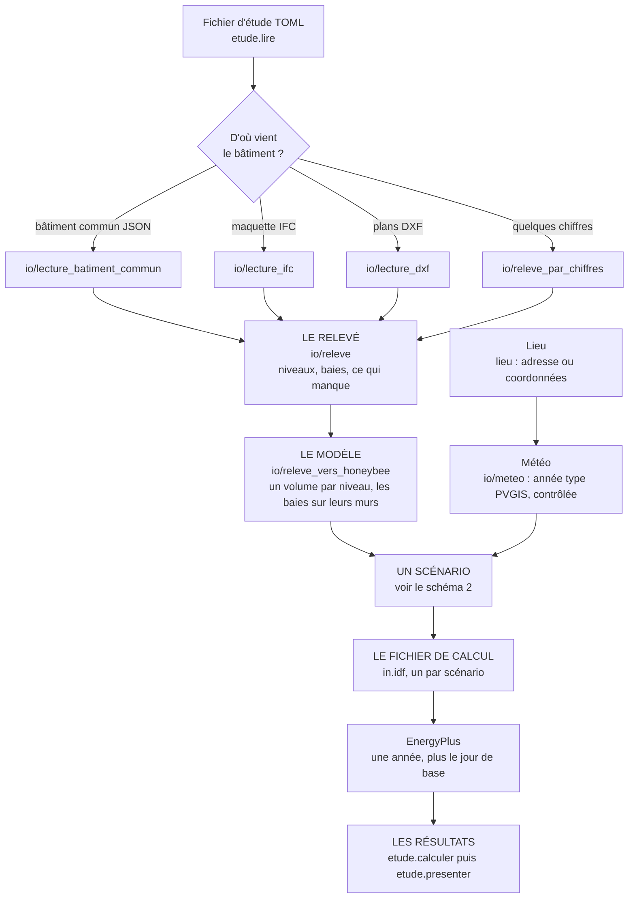
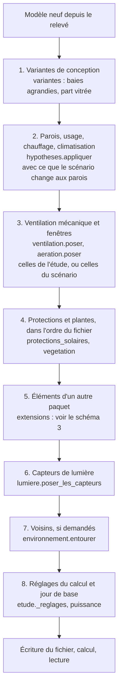
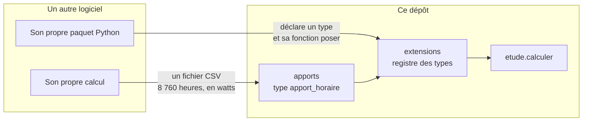

# Comment c'est fait

Ce document explique la chaîne de calcul de bout en bout, en schémas. Il se lit sans ouvrir le code ; chaque
case porte le nom du module qui la réalise, dans `src/rayflect/`.

## 1. La chaîne, d'un coup d'œil

Un fichier d'étude entre, un tableau de comparaison sort. Entre les 2, le bâtiment passe par 4 états : un
relevé, un modèle, un fichier de calcul, des résultats.

Le relevé est le pivot. Tout ce qui est en amont ne sert qu'à le produire, et tout ce qui est en aval ne
connaît que lui : ajouter une nouvelle source de bâtiment, c'est écrire un module qui rend un `Releve`.

## 2. Ce qui se passe dans un scénario

Chaque scénario repart du même relevé et refait le modèle. L'ordre des poses compte : ce qui règle les baies
vient avant ce qui s'appuie sur elles.

Le premier scénario sans aucun changement est la référence : c'est à lui que les autres se comparent, et ses
températures servent aux protections manœuvrées par les occupants.

## 3. Ouvrir l'outil à un autre logiciel

Il y a 2 façons de brancher quelque chose que ce dépôt ne connaît pas. Aucune ne demande de modifier le dépôt.

**Par un fichier.** L'autre logiciel fait son calcul de son côté et écrit, heure par heure, la chaleur qu'il
apporte ou retire aux locaux. Le type `apport_horaire` la lit et la donne à EnergyPlus. Les 2 programmes ne
se connaissent pas : ils n'ont en commun qu'un format de fichier, décrit dans `apports.py`.

**Par un paquet.** Un paquet Python déclare un type d'élément : un nom, une classe pour ses paramètres, une
fonction qui modifie le modèle ou ajoute du texte au fichier de calcul. Le fichier d'étude s'en sert alors
comme d'un type du dépôt. La marche à suivre est en tête de `extensions.py`.

Le bâtiment lui-même peut venir d'un autre logiciel sans maquette, par la table `[batiment]` : une emprise,
des niveaux, une aire de vitrage par orientation.

## 4. Ce qui entre

| Table du fichier d'étude | Ce qu'elle dit | Module |
|---|---|---|
| `maquette`, `[plan]` | Le bâtiment, depuis une maquette IFC, des plans DXF ou un bâtiment commun (JSON) | `io/lecture_ifc`, `io/lecture_dxf`, `io/lecture_batiment_commun` |
| `[batiment]` | Le bâtiment par ses chiffres, sans maquette ; `niveaux_non_chauffes`, `mitoyennes` | `io/releve_par_chiffres` |
| `[lieu]` | Une adresse, un nom de ville ou des coordonnées ; en découlent commune, altitude, zone climatique et température de base | `lieu`, `climat` |
| `usage`, `periode`, `fenetres`, `climatisation`, `consigne` | Qui occupe, depuis quand c'est construit, ce que tient le thermostat | `hypotheses`, `puissance` |
| `[usage_regle]` | Ce qu'on sait de l'usage au-delà de ses valeurs par défaut | `hypotheses.usage_regle` |
| `[parois]` | Isolant, vitrage, inertie | `hypotheses.Parois` |
| `[ventilation]` | Double flux, surventilation de nuit | `ventilation` |
| `[energie]` | L'énergie achetée, pour le CO2 et les euros | `energie` |
| `[dimensionnement]` | La température extérieure de base | `puissance` |
| `[objectifs]`, `[propositions]` | Les objectifs que `rayflect proposer` cherche à tenir, la palette et ses combinaisons | `propositions` |
| `[carbone]`, `[scenario.carbone]`, `carbone_kg` | Les facteurs, masses et matériaux du carbone construit ; le total d'une FDES | `carbone` |
| `[lieu] climat` | L'année type, une année réelle, l'été le plus chaud depuis 2000, le climat 2040-2049 ; une liste les compare | `io.climats`, `etude.calculer_par_climat` |
| `[sol]`, `convection_exterieure`, `[lieu] meteo` | Le sol sous le plancher, le vent sur les parois, un fichier météo donné | `exterieur` |
| `ombres_tous_les_n_jours` | L'espacement du calcul des ombres : 1 jour par défaut, à espacer si le calcul est trop long | `moteur` |
| `calculs_en_meme_temps` | Combien de scénarios calculer en même temps : la moitié des processeurs du poste par défaut, 1 pour les jouer l'un après l'autre | `moteur` |
| `[[scenario]]` | Ce qu'on compare : éléments, parois changées, âges d'une plantation | `etude`, et les modules du schéma 2 |
| élément `ouvrants` | Les fenêtres qu'un scénario ouvre : façades, heures, seuils, traversant ou non | `aeration` |
| élément `ventilation` | La ventilation mécanique d'un scénario : double flux, surventilation | `ventilation` |
| élément `mur_trombe` | L'allège des façades visées devient un mur lourd et sombre derrière une vitre | `trombe` |
| élément `sondes` | Un champ de sondes géothermiques posé sur les besoins du scénario | `sondes` |

Tout ce qui n'est pas donné prend une valeur par défaut, et le compte rendu dit laquelle et d'où elle vient.

## 5. Ce qui sort

`resultats.json` suit un format écrit à part, pour qu'un autre logiciel le lise sans lire ce code :
`src/rayflect/resultats.schema.json` (JSON Schema 2020-12), version 1. Chaque fichier le dit en tête :
`"format": {"nom": "rayflect-resultats", "version": 1, "empreinte": "…"}`. L'empreinte change dès que le schéma
change ; un lecteur garde celle qu'il sait lire. Un bilan qui ne suit pas son format n'est pas écrit.
`python -m rayflect.resultats resultats.json` contrôle un fichier.

Par scénario, dans `resultats.json` et dans le compte rendu :

| Sortie | Unité | D'où elle vient |
|---|---|---|
| Heures au-dessus de 26 °C, par niveau et par côté | heures d'occupation | Température ressentie d'EnergyPlus |
| Lumière du jour suffisante | part des heures d'occupation à 300 lux | `lumiere` |
| Trop de lumière et éblouissement, à 1 m de la baie | part des heures au-dessus de 2 000 et 3 000 lux, et d'un indice DGI de 22 | `lumiere` |
| Besoin de chauffage, besoin de froid sensible, froid avec la vapeur condensée | kWh par an | Charges idéales d'EnergyPlus |
| Énergie achetée, CO2, dépense | kWh, kg, euros | `energie` |
| Chauffage au jour de base, pointes de chauffage et de froid | kW | `puissance` |
| Une plantation dans le temps (`annees`) : taille, ombre végétale mois par mois, degrés-heures, chauffage, lumière, âge par âge | m, part du soleil des baies, °C.h, kWh | `trajectoire` |
| Carbone des matériaux ajoutés (A1 à A3), élément par élément ; CO2 évité par an et retour | kg CO2e, ans | `carbone` |
| Degrés-heures d'inconfort à la façon de la RE2020, heures au seuil + 1 et + 2 °C, part de la nuit en logement | °C.h et heures par an | `confort` |
| D'où vient la chaleur et où elle part : murs et baies par façade, toiture, plancher, air, apports, chauffage, froid | kWh par mois et par an | `bilan` |
| Production photovoltaïque | kWh par an | `protections_solaires` |
| Ce que le scénario change | texte | Chaque module le dit lui-même |
| Ce qui reste à demander | texte | Relevé, lieu, météo, énergie, dimensionnement |
| Ce qui a produit le résultat (clé `moteur`) : versions d'EnergyPlus, de Python et des paquets, réglages du calcul, nombre d'avertissements par scénario, nombre de calculs lancés ensemble | texte | `moteur` |
| Ce qu'un élément d'un autre paquet a lu de ses résultats (clé `extensions`, par scénario) | ce qu'il rend | `extensions` |
| Sondes géothermiques : température de l'eau qui revient du sol la première et la dernière année, dérive, part du froid servie en géocooling (sous `extensions`) | °C, K | `sondes` |

## 6. Les règles que le code suit

- **Chaque valeur porte son origine.** `[S]` lue dans une source citée, `[C]` citée par une autre source, `[D]`
  déduite par un calcul écrit dans le code, `[H]` hypothèse sans source, à remplacer ou à demander.
- **Ce qui manque se demande.** Un relevé incomplet ne s'invente pas : il liste ses manques, et le compte
  rendu les met en tête. Ce que la source dit et que le calcul ne prend pas encore est listé aussi
  (`Releve.non_lus`), jamais perdu en silence.
- **Un niveau non chauffé échange avec ses voisins.** Les niveaux chauffés de la même façon sont séparés par
  des planchers sans échange ; un niveau non chauffé est relié aux siens par un vrai plancher, et un mur
  mitoyen n'échange pas avec le dehors (`io/releve_vers_honeybee`).
- **Une limite s'écrit là où elle agit.** Ce qu'un module ne modélise pas est dit dans son en-tête et dans la
  feuille de route, pas seulement dans une note à part.
- **Un essai vérifie un sens physique, pas une valeur.** Plus de vitrage au sud demande plus de froid ; un
  arbre fait plus d'ombre en grandissant. Les valeurs, elles, se vérifient contre la norme ANSI/ASHRAE 140
  (`verification/`).
- **Un calcul fautif ne rend pas de chiffres.** EnergyPlus écrit ce qu'il remarque dans son journal
  (`eplusout.err`). Une erreur grave ou fatale arrête l'étude, et son message est rendu en clair (`moteur`).
- **Un scénario se joue en 4 temps, chacun dans sa fonction** (`etude.py`) : construire le bâtiment, écrire le
  fichier d'EnergyPlus, le lancer, lire ses résultats. Le fichier ne se retouche qu'à l'écriture, et l'année
  ne se lit que par `puissance.Annee`, qui écarte les 24 heures du jour de base et refuse une série qui
  n'est ni l'une ni l'autre.
- **Un calcul dit où il en est.** `etude.calculer` rend à qui le suit la liste des étapes, celle en cours, la
  part faite et le temps restant estimé (`etude.Avancement`). La part vient d'EnergyPlus lui-même, qui écrit
  la date de l'année qu'il calcule (`moteur.Suivi`) ; la commande `rayflect` l'affiche (`cli.Affichage`).
- **Lancer les scénarios ensemble ne change aucun chiffre.** Le bâtiment tel qu'il est se calcule d'abord,
  seul : ses températures servent aux occupants des scénarios suivants. Les autres sont lancés ensemble.
- **Un défaut lourd dit son poids.** Une hypothèse prise par défaut qui pèse 15 % ou plus sur le chauffage ou les
  degrés-heures (étanchéité, apports, inertie, U des murs et du toit) est citée dans « à demander », avec son poids
  mesuré par `verification/poids_des_hypotheses.py` (`hypotheses.POIDS_DES_HYPOTHESES`). Un poids se remesure quand un
  défaut change.
- **Un résultat suit son format.** Ajouter une clé facultative à `resultats.json` change l'empreinte du schéma ;
  retirer, renommer ou rendre obligatoire une clé change sa version (`resultats.py`).
- **Rien de téléchargé n'entre dans le dépôt.** La météo et les cartes vont dans un cache hors dépôt (`cache`).

## 7. Où regarder pour...

| Je veux... | J'ouvre... |
|---|---|
| Lire un nouveau format de bâtiment | `io/releve.py`, puis un des 4 modules de lecture comme exemple |
| Lire un bâtiment décrit par un autre logiciel, avec la provenance de chaque valeur | `io/lecture_batiment_commun.py` |
| Ajouter une protection solaire | `protections_solaires.py`, et `etude.TYPES` |
| Changer la façon dont les fenêtres s'ouvrent, ou le débit qui en sort | `aeration.py` |
| Relancer un second calcul sur les résultats d'un scénario | `sondes.py`, qui le fait pour la boucle de sol |
| Brancher un calcul fait ailleurs | `apports.py` |
| Déclarer un type depuis un autre paquet, retoucher le fichier d'EnergyPlus, lire une sortie de plus | `extensions.py` |
| Changer une hypothèse d'usage | `hypotheses.py`, ou `[usage_regle]` dans l'étude |
| Comprendre pourquoi une étude est refusée | `moteur.py`, et le journal `eplusout.err` du scénario |
| Comprendre un chiffre du compte rendu | `etude.calculer`, qui assemble tout |
| Lire `resultats.json` depuis un autre logiciel, ou y ajouter une clé | `resultats.schema.json`, puis `resultats.py` |
| Chercher les mesures qui tiennent des objectifs, ou changer la palette essayée | `propositions`, `etude.proposer` |
| Comprendre pourquoi un scénario chauffe moins ou surchauffe plus | `bilan`, le bilan par poste et par façade |
| Le confort d'été de la RE2020, et en quoi Rayflect s'en écarte | `confort` |
| Savoir ce qui n'est pas fait | `docs/FEUILLE_DE_ROUTE.md` |
